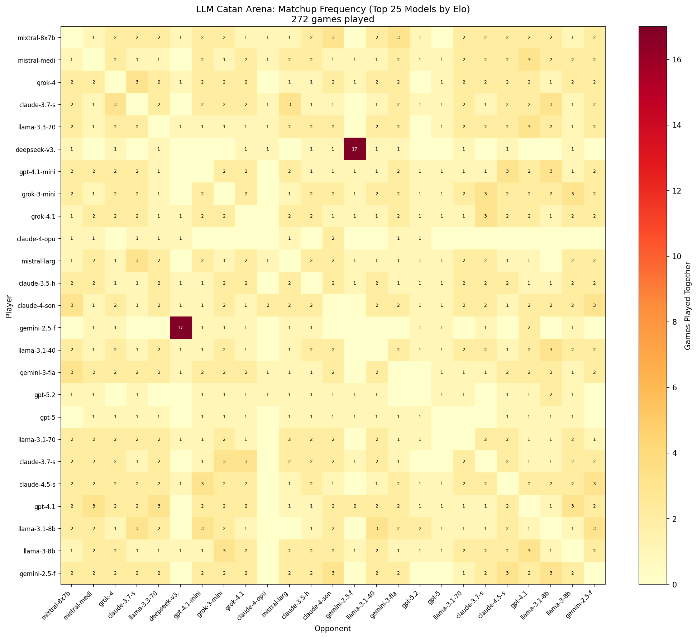

# LLM Catan Arena: Which AI Plays Settlers Best?

*Testing 48 LLMs across 272 games of Settlers of Catan*

## TL;DR
- **Surprise winner**: Mixtral 8x7B ($0.03/game) beats expensive flagships
- **Best value**: Mistral Medium (#2), DeepSeek V3.2 (#6) at <$0.20/game
- **Expensive ≠ Better**: Claude Opus models cost 100x more, rank #28-46
- **Budget models dominate**: Top 3 all cost under $0.50/game

## Top 10 Rankings

| Rank | Model | Elo | Win% | Cost/game |
|------|-------|-----|------|-----------|
| 1 | **mixtral-8x7b** | 1593 | 44% | $0.03 |
| 2 | **mistral-medium** | 1590 | 46% | $0.18 |
| 3 | **grok-4** | 1586 | 54% | $0.45 |
| 4 | claude-3.7-sonnet | 1570 | 42% | $0.68 |
| 5 | llama-3.3-70b | 1563 | 44% | $0.04 |
| 6 | deepseek-v3.2 | 1562 | 36% | $0.02 |
| 7 | gpt-4.1-mini | 1561 | 29% | $0.04 |
| 8 | grok-3-mini | 1549 | 33% | $0.10 |
| 9 | grok-4.1 | 1548 | 29% | $0.45 |
| 10 | claude-4-opus | 1544 | 44% | $3.38 |

## Key Findings

### 1. Open-source/budget models win
The top 3 models (Mixtral, Mistral Medium, Grok-4) all cost under $0.50/game.
Meanwhile, Claude Opus ($3.38/game) ranks #28-46.

### 2. Model size doesn't matter for Catan
- Mixtral 8x7B (46B params) beats GPT-5 (rumored 1T+ params)
- Llama 3.3 70B (#5) beats Llama 3.1 405B (#15)

### 3. Reasoning models underperform
- Claude 3.7 Sonnet Thinking (#20) vs regular (#4)
- qwen3-235b-thinking (#44) vs regular (#31)

Extended thinking may hurt fast tactical games where quick pattern recognition matters more than deep reasoning.

### 4. Cost efficiency winners

| Model | Elo | Cost/game | Value Score |
|-------|-----|-----------|-------------|
| DeepSeek V3.2 | 1562 | $0.02 | Best |
| Mixtral 8x7B | 1593 | $0.03 | Excellent |
| Llama 3.3 70B | 1563 | $0.04 | Excellent |
| gpt-4.1-mini | 1561 | $0.04 | Excellent |

## Matchup Heatmap

*Shows how many times each pair of models played against each other. Sorted by Elo ranking (best at top-left).*

## Methodology

- **272 games** of 4-player Settlers of Catan
- **48 models** from 8 providers:
  - Anthropic (Claude 3, 3.5, 3.7, 4, 4.5)
  - OpenAI (GPT-4o, 4.1, 5, 5.1, 5.2)
  - Google (Gemini 2.0, 2.5, 3)
  - Meta (Llama 3, 3.1, 3.3, 4)
  - Mistral (Small, Medium, Large, Mixtral)
  - xAI (Grok 3, 4, 4.1)
  - Alibaba (Qwen 2.5, 3)
  - DeepSeek (V3.1, V3.2, R1)

- **Text mode**: LLM receives game state as JSON, responds with action selection
- **Elo rating**: Multiplayer method with K=32, starting at 1500
- **84.5% pair coverage**: Most model pairs have played each other

## Limitations

- **Text mode only**: Tool-calling/MCP mode not tested yet
- **~25 games per model**: Confidence intervals still ~170 Elo points wide
- **Random matchups**: Not perfectly balanced round-robin
- **Single game type**: Results may not generalize to other games

## Cost

This experiment cost **~$280** for 272 games across 48 models.

| Category | Cost |
|----------|------|
| Average per game | ~$1.00 |
| Average per model-game | ~$0.25 |
| Most expensive model (Claude Opus) | ~$3.38/game |
| Cheapest models (Llama 8B, Gemini Flash) | ~$0.01/game |

## Data & Code

- **Full leaderboard**: [leaderboard.csv](leaderboard.csv)
- **Matchup matrix**: [matchup_matrix.csv](matchup_matrix.csv)
- **Game logs**: Available in `data/games/` directory

## Future Work

- [ ] Test MCP/tool-calling mode (structured function calls vs text)
- [ ] More games per model for tighter confidence intervals
- [ ] Other games: Chess, Poker, Diplomacy
- [ ] Analyze game logs for strategy patterns

---

*Want to see MCP mode results? More games? Different games?
This research is self-funded. Contributions welcome!*

**Contact**: [your contact info]

**Last updated**: February 2026
